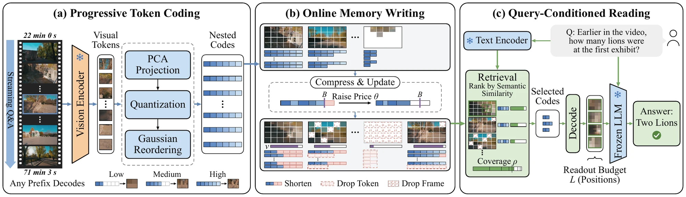
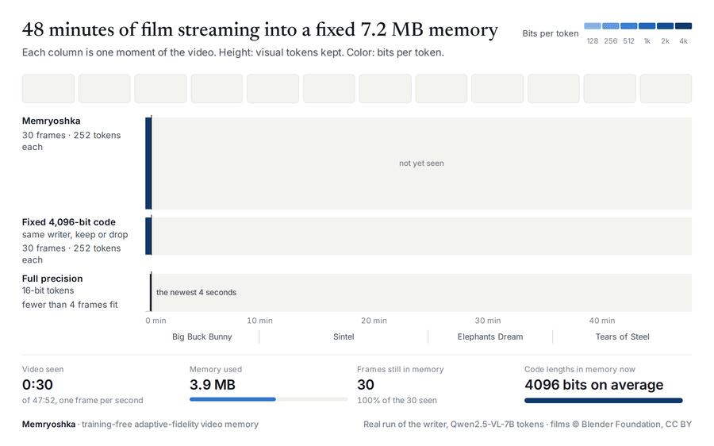

<h1 align="center">
  
  &nbsp;Memryoshka: Adaptive-Fidelity Video Memory for Streaming VLMs
</h1>

<p align="center">
  <a href="https://armenjeddi.github.io/memryoshka/"></a>
  <a href="https://github.com/armenjeddi/memryoshka"></a>
  
  <a href="LICENSE"></a>
</p>

This repository provides the code for Memryoshka, a training-free memory for streaming vision-language models (VLMs).
It is based on our paper *Memryoshka: Adaptive-Fidelity Video Memory for Streaming VLMs* (coming soon). The project page
is at [armenjeddi.github.io/memryoshka](https://armenjeddi.github.io/memryoshka/).

A VLM that watches a long stream has to store what it sees before anyone asks a question, in a memory of fixed size.
At one frame per second, Qwen2.5-VL-7B turns an hour of video into about 6.6 GB of visual tokens. Memryoshka stores each
visual token as a nested code: a shorter code inside a longer one, like Russian Matryoshka dolls. When the memory is
full, one price per bit decides which codes to shorten and which to drop, so old evidence loses detail before it is
lost. With a 7.2 MB memory, Memryoshka is ahead of every bounded visual-memory baseline on four long-video benchmarks,
and averaged over six benchmarks it scores as well as a memory that keeps every visual token and is read the same way
(59.7% against 59.4%).
Nothing is trained: the vision encoder, the language model and the retrieval model stay frozen, and the only fitted part
is a PCA basis, which ships with this repository.

<p align="center">
  
</p>

## Contents

- [Installation](#installation)
- [Getting started](#getting-started)
- [How it works](#how-it-works)
- [Results](#results)
- [Evaluation](#evaluation)
- [Repository layout](#repository-layout)
- [Development](#development)
- [Citation](#citation)
- [License](#license)

## Installation

Memryoshka needs Linux, Python 3.11 and one NVIDIA GPU with 24 GB of memory or more (the demo below used 18 GB on an
NVIDIA L40S).

```bash
$ git clone https://github.com/armenjeddi/memryoshka.git && cd memryoshka
$ python3.11 -m venv .venv && source .venv/bin/activate
$ pip install -e .
$ python scripts/download_models.py      # Qwen2.5-VL-7B-Instruct (16.6 GB) and LongCLIP-B (0.6 GB), pinned revisions
```

The PCA basis (7.4 MB) is in `memryoshka/assets/` and needs no download. The writer and the readout use only NumPy, so
`memryoshka.Memory` also runs on a CPU from saved encoder outputs.

## Getting started

The demo video is four Blender open films played back to back at one frame per second (47 min 52 s, CC BY):

```bash
$ scripts/open_films.sh data/open_films                  # downloads 2.4 GB and builds data/open_films/open_films_1fps.mp4
$ python demo.py data/open_films/open_films_1fps.mp4 --save open_films.mryk
$ python ask.py open_films.mryk --question "What kind of creature does the young woman carry and protect?" \
      --options "A baby dragon" "A rabbit" "A robot" "A bird"
```

On one L40S GPU, writing the 48-minute video takes about 6 minutes. `demo.py` prints a line every 300 frames and then:

```
Video seen: 2872 frames, the last at 47:51; about 252 visual tokens per frame
Memory: 6.97 MB of 7.17 MB
Frames still in memory: 1653 of 2872 (58%), 48 tokens per kept frame on average
Bits per kept token: 581 on average (a 16-bit token is 57,344 bits)
Code lengths in memory: 256 bits: 9634, 512 bits: 55315, 1024 bits: 14967, 2048 bits: 211
Every visual token at 16 bits would take 5.19 GB, 744 times more; at 16 bits the same memory would hold 3 whole frames
Saved to open_films.mryk
```

`ask.py` reads only the saved memory, not the video:

```
Read 26 of 1653 stored frames, 765 tokens, 999 of 1000 positions
Frames read (seconds): 82, 89, 95, 187, 213, 275, 279, 317, 409, 453, 809, 811, 917, 924, 931, 1147, 1150, 1151, 1157, 1158, 1174, 1188, 1194, 1205, 2525, 2609
  (A) A baby dragon: log-probability -0.01  <- answer
  (B) A rabbit: log-probability -6.01
  (C) A robot: log-probability -4.89
  (D) A bird: log-probability -6.76
```

How this memory changes as the stream grows (each column is one moment of the video; height is the number of visual
tokens kept, color the bits per token):

<p align="center">
  
</p>

The same in Python:

```python
from memryoshka import Memryoshka

system = Memryoshka()                                   # frozen Qwen2.5-VL-7B and LongCLIP-B/16
memory = system.memory(budget_bytes=7_168_000)          # 7.2 MB: the size of 1,000 visual tokens at 16 bits
system.stream("data/open_films/open_films_1fps.mp4", memory)   # written frame by frame, without any question
result = system.ask(memory, "What kind of creature does the young woman carry and protect?",
                    ["A baby dragon", "A rabbit", "A robot", "A bird"])
print(result["answer"], result["times"])               # the letter, and the moments (in seconds) the reader looked at
```

`memory.save()` and `Memory.load()` keep a memory between sessions; the file is exactly as large as the memory budget
says (at most 7,168,000 bytes here).

## How it works

**1. Nested token codes** ([`memryoshka/codec.py`](memryoshka/codec.py)). Each visual token (3,584 numbers) is projected
onto 512 PCA directions. Each coefficient is divided by its standard deviation and quantized to 8 bits, for 4,096 bits in
all. The bits are put in one fixed order, by how much each is expected to reduce the reconstruction error, with a more
significant bit always before a less significant one of the same coefficient. Any prefix of this order decodes to an
approximate token, and a longer prefix to a closer one, so shortening a stored code is just dropping its end. The share
of the PCA variance a prefix of r bits keeps, e(r), follows from the PCA spectrum without training.

**2. One price per bit** ([`memryoshka/writer.py`](memryoshka/writer.py)). Every stored token can be dropped or kept at
32, 64, ..., 4,096 bits. Keeping r bits is worth importance x novelty x (e(r) - 0.5) and costs the price times (r + 24)
bits, where importance is the attention the token receives in the vision encoder's last full-attention layer and novelty
is how different its frame is from the previous 8 frames. Each token takes the option with the largest value minus cost,
and a frame stays only if its tokens pay for the frame's own 4,152 bits (search tag, timestamp and novelty). When a new
frame would overflow the budget, the price rises until the memory fits in 90% of it. A higher price can only shorten or
remove codes, so nothing is re-encoded.

**3. Reading when a question arrives** ([`memryoshka/readout.py`](memryoshka/readout.py),
[`memryoshka/reader.py`](memryoshka/reader.py)). The question and its options are embedded with LongCLIP's text encoder,
and the stored frames are ranked by cosine similarity to it. Going down the ranking, each frame contributes its most
important stored tokens, enough to hold 80% of the frame's stored importance, until the readout budget is used
(1,000 positions by default, counting visual tokens, timestamps and delimiters). The frozen reader gets the decoded tokens
in their original places, frame by frame in time order, and answers.

The memory budget and the readout budget are separate: the memory can hold far more of the video than the reader looks at
for any one question.

## Results

All numbers are from the paper. The reader is a frozen Qwen2.5-VL-7B at one frame per second, and every memory is written
without knowing the questions. In the main comparison the memory budget equals the size of the readout at full precision.
**Bold** marks the best result in each column at that budget, among methods with a bounded memory.

Memory 7.2 MB, readout 1,000 positions (accuracy, %):

| Method | LVBench | LongVideoBench | Video-MME | TimeScope | OVO-Bench | StreamingBench | Average |
| --- | ---: | ---: | ---: | ---: | ---: | ---: | ---: |
| *Base model, uncapped memory (reference)* | *44.5* | *54.4* | *49.6* | *85.6* | *52.5* | *69.9* | *59.4* |
| *Uniform sampling of the full past video (reference)* | *30.1* | *41.8* | *43.6* | *27.8* | *57.0* | *76.2* | *46.1* |
| SimpleStream | 27.2 | 39.9 | 41.5 | 24.4 | 62.3 | 78.1 | 45.6 |
| KeyRec | 27.2 | 41.0 | 39.8 | 24.4 | 62.4 | 77.5 | 45.4 |
| CausalMem | 33.4 | 46.6 | 45.2 | 57.2 | 61.8 | 78.3 | 53.8 |
| SAVEMem | 27.9 | 36.2 | 40.0 | 26.1 | **64.6** | 79.8 | 45.8 |
| Memryoshka | **45.7** | **52.3** | **50.1** | **86.1** | 53.2 | 70.6 | 59.7 |
| Memryoshka + 4 recent frames | 45.5 | 51.4 | **50.1** | 84.4 | 60.3 | **80.1** | **62.0** |

<details>
<summary>Memory 14.3 MB (readout 2,000) and 28.7 MB (readout 4,000)</summary>

| Method | LVBench | LongVideoBench | Video-MME | TimeScope | OVO-Bench | StreamingBench | Average |
| --- | ---: | ---: | ---: | ---: | ---: | ---: | ---: |
| **14.3 MB** | | | | | | | |
| *Base model, uncapped memory (reference)* | *46.9* | *56.4* | *50.8* | *94.4* | *54.9* | *72.9* | *62.7* |
| *Uniform sampling of the full past video (reference)* | *34.4* | *47.0* | *49.7* | *41.1* | *57.4* | *77.3* | *51.2* |
| SimpleStream | 27.8 | 41.7 | 42.7 | 30.0 | 63.0 | 79.8 | 47.5 |
| KeyRec | 27.9 | 42.9 | 41.3 | 24.4 | 61.9 | 78.7 | 46.2 |
| CausalMem | 35.1 | 49.5 | 45.9 | 60.0 | 62.7 | 80.3 | 55.6 |
| SAVEMem | 28.9 | 39.0 | 41.1 | 32.2 | **64.2** | 81.1 | 47.8 |
| Memryoshka | **48.4** | **58.7** | 52.4 | **93.9** | 54.7 | 73.0 | 63.5 |
| Memryoshka + 4 recent frames | 47.2 | 57.5 | **52.6** | 88.9 | 59.7 | **81.6** | **64.6** |
| **28.7 MB** | | | | | | | |
| *Base model, uncapped memory (reference)* | *49.4* | *58.2* | *52.7* | *95.0* | *56.6* | *76.0* | *64.6* |
| *Uniform sampling of the full past video (reference)* | *36.5* | *48.9* | *53.1* | *47.2* | *59.4* | *79.4* | *54.1* |
| SimpleStream | 30.7 | 44.0 | 43.3 | 30.0 | 61.2 | 80.2 | 48.2 |
| KeyRec | 29.6 | 43.3 | 42.2 | 27.8 | 61.8 | 79.9 | 47.4 |
| CausalMem | 35.6 | 52.3 | 45.4 | 64.4 | 62.4 | 80.7 | 56.8 |
| SAVEMem | 32.1 | 43.4 | 43.0 | 37.2 | **64.5** | 80.9 | 50.2 |
| Memryoshka | 49.7 | **58.0** | 53.7 | 95.0 | 56.6 | 76.1 | 64.8 |
| Memryoshka + 4 recent frames | **50.0** | 56.9 | **54.2** | **95.6** | 59.4 | **81.6** | **66.3** |

</details>

- **Long videos.** On LVBench, LongVideoBench, Video-MME and TimeScope, Memryoshka is ahead of every bounded baseline at
  every budget. The largest gains over CausalMem are on TimeScope (28.9 to 33.9 points) and LVBench (12.3 to 14.1
  points), where evidence from long ago matters most.
- **Streaming.** OVO-Bench and StreamingBench mostly ask about what is on screen now. Always adding the four newest frames
  to the readout raises Memryoshka by 2.8 to 9.5 points on these two benchmarks; that variant has the best
  StreamingBench accuracy and the best six-benchmark average at every budget, while SAVEMem stays best on OVO-Bench.
- **Against KV-cache memories** (LVBench). Five streaming KV-cache methods reach 31.6% to 40.4% while storing 1.1 to
  54.6 GB per video; Memryoshka reaches 45.7% to 49.7% with 7.2 to 28.7 MB.
- **Beyond video question answering.** As the memory of a robot policy on RMBench, Memryoshka reaches 95% success with
  256 KiB of storage, against 94% for the policy's own history of up to 23.4 MiB. For audio and video together
  (Qwen2.5-Omni-7B on LVOmniBench), it reaches 33.7% with 7.2 MB, against 32.0% reported for the full input of about
  1.1 GB per video. This repository covers the video question answering setting.

## Evaluation

```bash
$ python evaluate.py --questions data/lvbench.jsonl --videos /data/lvbench/videos --out results/lvbench_7mb.jsonl
$ python evaluate.py ... --budget-mb 14.336 --readout 2000          # the 14.3 MB setting
$ python evaluate.py ... --recent 4                                  # the "+ 4 recent frames" variant
```

Questions are one JSON object per line, with the video, the question, the options, the correct letter and, for
streaming questions, the time at which the question is asked. A question with a time is answered from the memory as it
was at that moment. [docs/evaluation.md](docs/evaluation.md) describes the format, the benchmarks and the settings of
each table.

## Repository layout

```
memryoshka/
  codec.py        nested token codes: PCA, 8-bit quantization, bit order, decoding any prefix, e(r)
  writer.py       the memory: one price per bit, exact byte accounting, saving and loading
  readout.py      ranking stored frames for a question and choosing tokens under the readout budget
  features.py     frames at 1 fps, Qwen2.5-VL visual tokens, token importance, LongCLIP tags
  longclip.py     LongCLIP-B/16 frame and question embeddings
  reader.py       decoded tokens back in place for the frozen Qwen2.5-VL reader; multiple-choice answers
  pipeline.py     Memryoshka: the models loaded once, stream() and ask()
  models.py       model revisions and where they are kept
  assets/         the PCA basis (pca_basis.npz) and the list of videos it was fitted on
demo.py           stream one video into memory and print what it keeps
ask.py            answer a question from a saved memory
evaluate.py       benchmark evaluation (docs/evaluation.md)
scripts/          model download, demo video
tests/            unit tests (CPU only, no models)
```

## Development

```bash
$ pip install -e ".[dev]"
$ pytest          # CPU only, about 10 seconds
```

## Citation

```bibtex
@misc{jeddi2026memryoshka,
  title  = {Memryoshka: Adaptive-Fidelity Video Memory for Streaming {VLMs}},
  author = {Jeddi, Ahmadreza and Zhang, Enming and Gerigk, Jasper and Chandhok, Shivam and
            Nasr Azadani, Mozhgan and Karaimer, Hakki Can and Liu, Yize and Sigal, Leonid and
            Gilitschenski, Igor and Derpanis, Konstantinos G. and Pavone, Marco and Taati, Babak},
  year   = {2026},
  url    = {https://armenjeddi.github.io/memryoshka/}
}
```

Ahmadreza Jeddi and Enming Zhang contributed equally. Corresponding author: Ahmadreza Jeddi ([ajeddi@cs.toronto.edu](mailto:ajeddi@cs.toronto.edu)).

## License

The code is released under the [MIT license](LICENSE), Copyright (c) 2026 The Memryoshka Authors. The models keep their
own licenses: Qwen2.5-VL-7B-Instruct and LongCLIP are released under Apache 2.0. The demo films are © Blender Foundation
under Creative Commons Attribution licenses.

## Acknowledgements

Memryoshka builds on [Qwen2.5-VL](https://github.com/QwenLM/Qwen2.5-VL) and
[LongCLIP](https://github.com/beichenzbc/Long-CLIP). The demo uses the Blender Foundation's open films *Big Buck Bunny*,
*Sintel*, *Elephants Dream* and *Tears of Steel*.
